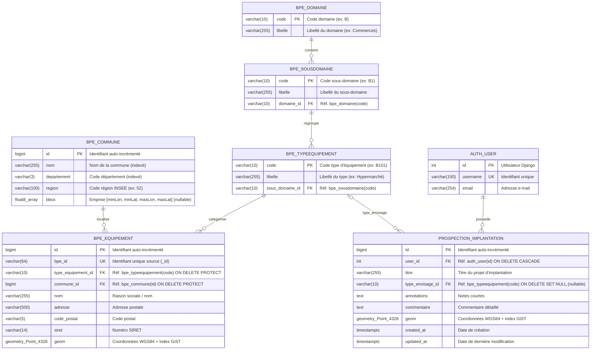

# Modèle de données — Geo Prospector (BPE 2025 & Prospection)

Ce document présente le modèle relationnel et spatial PostgreSQL / PostGIS de l'application, conçu à partir du fichier plat Parquet de la Base permanente des équipements (BPE 2025, INSEE).

## 1. Diagramme entité-association (Mermaid)



## 2. Normalisation du fichier source Parquet

Le fichier source `bpe.parquet` contient environ **2,92 millions de lignes** (France entière) sous forme d'une table plate dénormalisée de 16 colonnes (`_id`, `nom`, `adresse`, `codepostal`, `ville`, `dept`, `region`, `domaine1_code`, `domaine1_libelle`, `domaine2_code`, `domaine2_libelle`, `domaine3_code`, `domaine3_libelle`, `SIRET`, `lon`, `lat`).

Lors de l'exécution de `python manage.py import_bpe`, les données sont filtrées sur la région **Pays de la Loire (`BPE_REGION=52`, 142 580 lignes)** et réorganisées en tables relationnelles :

- **Nomenclature hiérarchique sur 3 niveaux** (`bpe_domaine`, `bpe_sousdomaine`, `bpe_typeequipement`) : permet de structurer les filtres multi-niveaux de l'interface et d'éviter la redondance des libellés sur plus de 136 000 lignes (7 domaines, 27 sous-domaines et 232 types pour la région 52).
- **Identification des communes par `(nom, departement)`** : le fichier Parquet nettoyé ne comporte pas de code INSEE commune (`DEPCOM` / `CODGEO`). La table `bpe_commune` (1 228 communes en région 52) utilise donc une contrainte d'unicité `UNIQUE(nom, departement)` (`commune_unique_nom_dept`) afin d'éviter les collisions entre homonymes de départements différents, tout en stockant l'emprise `bbox` (`[minLon, minLat, maxLon, maxLat]`) calculée via PostGIS (`Extent`).
- **Équipements (`bpe_equipement`)** : regroupe les **136 569 équipements** valides de la région 52 (6 011 lignes sans coordonnées `lon`/`lat`, type ou ville sont écartées à l'import) avec un identifiant source `bpe_id` unique et des clés étrangères protégées (`ON DELETE PROTECT`) vers `bpe_typeequipement` et `bpe_commune`.

## 3. Séparation entre référentiel BPE et implantations utilisateur

- **Référentiel BPE (`bpe_*`)** : données publiques en lecture seule via l'API, alimentées uniquement par la commande d'import.
- **Implantations potentielles (`prospection_implantation`)** : données privées rattachées à l'utilisateur connecté (`user_id` avec `ON DELETE CASCADE`) et liées optionnellement (`ON DELETE SET NULL`) à un type de commerce envisagé (`bpe_typeequipement`). Chaque utilisateur n'a accès qu'à ses propres points (l'accès à l'implantation d'un autre utilisateur renvoie `404`).

## 4. Systèmes de coordonnées (SRID 4326) et indexation

- **SRID 4326 (WGS 84)** : toutes les colonnes géométriques (`bpe_equipement.geom` et `prospection_implantation.geom`) sont stockées en `geometry(Point, 4326)` (`[longitude, latitude]`), directement compatibles avec le standard GeoJSON (RFC 7946) et MapLibre GL JS.
- **Index spatial GiST** : créé sur `geom` pour accélérer les requêtes d'intersection spatiale lors des déplacements sur la carte (`in_bbox` et tuiles).
- **Contraintes et index relationnels** :
  - `UNIQUE` sur `bpe_equipement.bpe_id` ;
  - `UNIQUE(nom, departement)` sur `bpe_commune` ;
  - index composite `(type_equipement_id, commune_id)` sur `bpe_equipement` ;
  - index B-tree sur `bpe_commune.nom` et `bpe_commune.departement` pour l'autocomplétion des villes.

## 5. Commandes pour obtenir le SQL et inspecter la base

Pour afficher le DDL SQL généré par les migrations Django :

```powershell
docker compose exec backend python manage.py sqlmigrate bpe 0001
docker compose exec backend python manage.py sqlmigrate prospection 0001
```

Pour inspecter directement les tables, contraintes et index dans PostgreSQL / PostGIS :

```powershell
docker compose exec db psql -U bpe -d bpe -c "\dt"
docker compose exec db psql -U bpe -d bpe -c "\d bpe_equipement"
docker compose exec db psql -U bpe -d bpe -c "\d prospection_implantation"
```